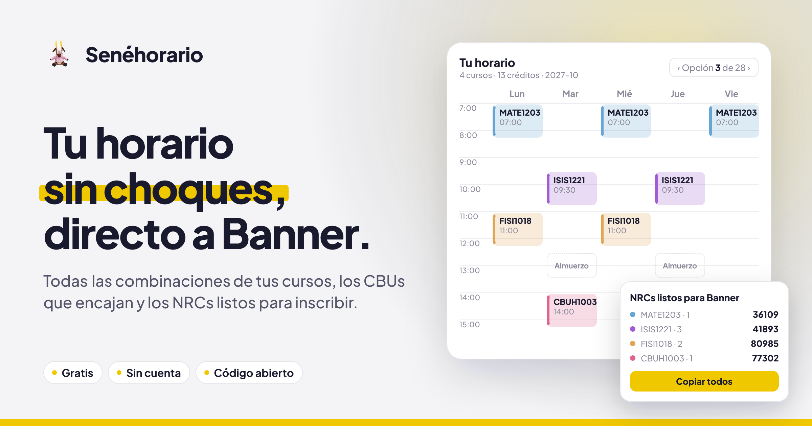

# Senéhorario

<a href="https://senehorario.cmolina.xyz">
  <picture>
    <source media="(prefers-color-scheme: dark)" srcset=".github/banner-dark.png">
    
  </picture>
</a>

A free, open-source schedule planner for Universidad de los Andes students. Search the official course catalog, pick the sections that work for you, browse every clash-free combination, and copy the NRCs straight into Banner.

**Live:** [senehorario.cmolina.xyz](https://senehorario.cmolina.xyz) · **What's new:** [senehorario.cmolina.xyz/novedades](https://senehorario.cmolina.xyz/novedades)

## Features

**Plan**
- Search the catalog by course code, name, NRC or professor, with seats, cycle (16 weeks, 8A, 8B), professors and meeting times for every section.
- Pick the term to plan for; when the catalog publishes two semesters at once, schedules never mix them.
- Add sections one by one, all of a course's sections, or only those with open seats.
- Every combination without clashes, shown on a weekly calendar. Half-semester (8A/8B) sections are combined into one view, and only the classes that change animate when you switch options.
- **"Elige uno" groups:** group electives or CBUs and every schedule includes exactly one of them.
- **CBUs that fit:** see which CBUs fit into the gaps of the option on screen, filtered by type and area.

**Refine**
- **Preferences:** sort options by fewest gaps, fewest days, latest start or earliest end; set no classes before/after a time; keep days free; block time for lunch, work or sports (drawn on the calendar).

**Register and share**
- **NRCs for Banner:** copy one NRC or the whole option's list.
- **Share links** that reopen the plan, with fresh data, on any device.
- **Calendar export** (`.ics`) of the chosen option, as weekly classes in Bogotá time for Google Calendar, Apple Calendar or Outlook.
- **Saved plans:** save, download and import several plans.

**Stay current**
- Saved sessions and plans are re-checked against the live catalog when opened; a notice lists sections that filled up, changed time or were removed.

Also: light and dark themes, a phone layout with a bottom tab bar and day-by-day agenda, and reduced motion respected throughout.

## How it works

- **Catalog data** comes from the public Uniandes course catalog through two small API routes (`/api/courses`, `/api/courses/cbu`) that normalize it into courses, sections and meetings. Searches always hit the live catalog; only the landing page's CBU count is cached (6 hours).
- **Schedule generation runs in the browser** (backtracking over one slot per course, or per "elige uno" group), so every change is instant. It's capped at 2,000 combinations to keep the page responsive.
- **Your data stays in your browser.** Selections, saved plans and preferences live in `localStorage`; there are no accounts and no database. Share links only carry the term, course codes and NRCs.
- **Analytics:** the site uses Google Analytics to count visits.

## Roadmap

- [x] Search by professor.
- [x] Suggest CBUs that fit into the gaps of your schedule.
- [x] Save, view and switch between multiple plans.
- [x] Choose between courses ("elige uno" groups), e.g. electives where you only need one.
- [x] Block time for non-class commitments.
- [x] Copy NRCs for Banner, share plans by link, export to calendar.
- [ ] Show professor ratings from Los Estudiantes inside the app.

## Project structure

A single Next.js app (React, TypeScript, Tailwind CSS, FullCalendar), deployed on Vercel.

```
src/
  app/
    page.tsx                  landing page (+ landing.css, the original page's styles)
    planning/page.tsx         planner
    novedades/page.tsx        changelog page
    api/courses/route.ts      GET /api/courses?q=&professor=   (catalog search)
    api/courses/cbu/route.ts  GET /api/courses/cbu             (all CBU courses)
    opengraph-image.tsx       link-preview image
    brand/[theme]/route.tsx   README banner at 2× (/brand/light, /brand/dark)
    sitemap.ts, robots.ts
  components/
    planner/                  planner UI: search, courses, CBUs, calendar, agenda,
                              details drawer, preferences, NRCs, sharing, plans
      usePlanner.ts           selection state, generation, refresh, persistence
    landing/HeroDemo.tsx      the live mini-planner on the landing page
    ui.tsx                    shared primitives (buttons, menu, popover, skeletons)
  content/
    changelog.ts              entries for /novedades and the landing page
  lib/
    uniandes.ts               catalog client + mapping (server only)
    scheduler.ts              conflict detection and schedule generation
    groups.ts                 "elige uno" groups → generation slots
    preferences.ts            filters, blocked time, sorting
    refresh.ts                re-checking saved plans against the catalog
    share.ts, ics.ts          share links and calendar export
    brand-card.tsx            link-preview / README banner design (next/og)
    calendar-events.ts        schedules → FullCalendar events (8A/8B handling)
    terms.ts, storage.ts, format.ts, types.ts, …
```

## Development

Requires Node.js 20.9+.

```bash
npm install
npm run dev        # http://localhost:3000
npm test           # unit tests (Vitest)
npm run lint
npm run typecheck
npm run build
```

Optional environment variable: `UNIANDES_API_BASE_URL` (defaults to `https://ofertadecursos.uniandes.edu.co/api/courses`).

## Contributing

Issues and pull requests are welcome.

- The scheduling, data and sharing logic lives in `src/lib/` and is covered by unit tests next to each file (`*.test.ts`); please add tests for changes there.
- When you ship something students would notice, add an entry at the top of `CHANGELOG` in `src/content/changelog.ts`. It appears on [/novedades](https://senehorario.cmolina.xyz/novedades) and, if it's among the newest three, on the landing page.

## Deployment

Every push to `main` deploys to Vercel; pull requests get preview URLs. The `gh-pages` branch only holds a redirect from the old address (`cmolina.xyz/senehorario/`), which also carries visitors' saved plans over to the new site.

## History

Senéhorario started in June 2025 as an Angular frontend with a Spring Boot backend ([archived](https://github.com/cmolina12/senehorario-backend)) and launched on 30 July 2025. In November 2026 it became a single Next.js app. The full, student-facing history is on [/novedades](https://senehorario.cmolina.xyz/novedades).

## License

MIT, see [LICENSE](LICENSE).
