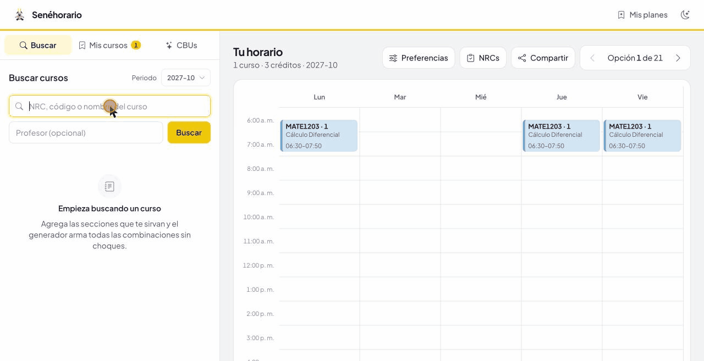
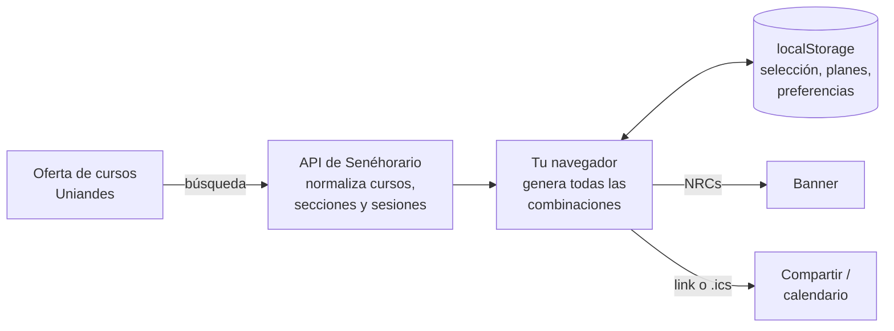

<a href="https://senehorario.cmolina.xyz">
  <picture>
    <source media="(prefers-color-scheme: dark)" srcset=".github/banner-dark.png">
    
  </picture>
</a>

<p align="center">
  Planificador de horarios gratuito y de código abierto para estudiantes de la Universidad de los Andes.<br>
  Busca en la oferta oficial, recorre todas las combinaciones sin choques y copia los NRCs directo a Banner.
</p>

<p align="center">
  <a href="https://senehorario.cmolina.xyz"></a>
  <a href="https://github.com/cmolina12/senehorario/actions/workflows/ci.yml"></a>
  <a href="https://senehorario.cmolina.xyz/novedades"></a>
  <a href="LICENSE"></a>
</p>

> [!NOTE]
> **English:** a schedule planner for Universidad de los Andes students. The app and its docs are in Spanish; code and commits are in English.

<p align="center">
  
</p>

## Funcionalidades

| Función | Qué hace |
|---|---|
| 🔎 **Busca** | Por código, nombre, NRC o profesor, con cupos, ciclo (16 semanas, 8A, 8B), profesores y horarios de cada sección. Agrega secciones una por una, todas o solo las que tienen cupos. |
| 🗓️ **Todas las combinaciones** | Cada horario posible sin choques en un calendario semanal, con las secciones 8A/8B combinadas. Al cambiar de opción solo se animan las clases que cambian. |
| 🎯 **Grupos «elige uno»** | Agrupa electivas o CBUs y cada horario incluye exactamente uno de ellos. |
| ✨ **CBUs que encajan** | Los CBUs que caben en los huecos de la opción en pantalla, filtrados por tipo y área. |
| ⚙️ **Preferencias** | Ordena por menos huecos, menos días, entrada más tarde o salida más temprano; evita clases antes o después de cierta hora; deja días libres; bloquea tiempo para almorzar, trabajar o hacer deporte. |
| 📋 **NRCs para Banner** | Copia un NRC o la lista completa de la opción. |
| 🔗 **Comparte y exporta** | Links que abren el plan con datos actualizados en cualquier dispositivo, y exportación `.ics` para Google Calendar, Apple Calendar u Outlook. |
| 💾 **Planes guardados** | Guarda, descarga e importa varios planes. Al abrirlos se revisan contra la oferta en vivo y un aviso muestra las secciones que se llenaron, cambiaron de horario o desaparecieron. |
| 📅 **Periodos** | Cuando la oferta publica dos semestres a la vez, eliges cuál planear y los horarios nunca los mezclan. |

Además: tema claro y oscuro, una versión para celular con barra inferior y agenda día por día, y respeto por la preferencia de movimiento reducido.

## Cómo funciona



- **La oferta siempre está en vivo.** Dos rutas de API (`/api/courses`, `/api/courses/cbu`) consultan el catálogo público de Uniandes; solo el conteo de CBUs de la página de inicio se guarda en caché (6 horas).
- **Los horarios se generan en el navegador** (backtracking con un espacio por curso o por grupo «elige uno»), así que cada cambio es instantáneo. El límite es de 2.000 combinaciones para que la página siga respondiendo.

> [!TIP]
> **Tus datos se quedan en tu navegador.** No hay cuentas ni base de datos: la selección, los planes y las preferencias viven en `localStorage`, y los links para compartir solo llevan el periodo, los códigos de los cursos y los NRCs. El sitio usa Google Analytics para contar visitas.

## Hoja de ruta

- [ ] Mostrar las calificaciones de profesores de Los Estudiantes dentro de la app.

¿Tienes una idea? [Abre un issue](https://github.com/cmolina12/senehorario/issues/new). Lo que ya salió está en [Novedades](https://senehorario.cmolina.xyz/novedades).

## Desarrollo

Requiere Node.js 20.9 o superior.

```bash
npm install
npm run dev        # http://localhost:3000
npm test           # pruebas unitarias (Vitest)
npm run lint
npm run typecheck
npm run build
```

Variable de entorno opcional: `UNIANDES_API_BASE_URL` (por defecto `https://ofertadecursos.uniandes.edu.co/api/courses`).

<details>
<summary><strong>Estructura del proyecto</strong></summary>

<br>

Una sola app de Next.js (React, TypeScript, Tailwind CSS, FullCalendar), desplegada en Vercel.

```
src/
  app/
    page.tsx                  página de inicio (+ landing.css, estilos de la página original)
    planning/page.tsx         planificador
    novedades/page.tsx        página de novedades
    api/courses/route.ts      GET /api/courses?q=&professor=   (búsqueda en la oferta)
    api/courses/cbu/route.ts  GET /api/courses/cbu             (todos los CBUs)
    opengraph-image.tsx       imagen de vista previa de links
    brand/[theme]/route.tsx   banner del README a 2× (/brand/light, /brand/dark)
    sitemap.ts, robots.ts
  components/
    planner/                  interfaz del planificador: búsqueda, cursos, CBUs, calendario,
                              agenda, detalles, preferencias, NRCs, compartir, planes
      usePlanner.ts           estado de la selección, generación, revisión, persistencia
    landing/HeroDemo.tsx      el mini planificador animado de la página de inicio
    ui.tsx                    componentes base (botones, menú, popover, skeletons)
  content/
    changelog.ts              entradas de /novedades y de la página de inicio
  lib/
    uniandes.ts               cliente de la oferta + transformación (solo servidor)
    scheduler.ts              detección de choques y generación de horarios
    groups.ts                 grupos «elige uno» → espacios de generación
    preferences.ts            filtros, tiempo bloqueado y orden
    refresh.ts                revisión de planes guardados contra la oferta
    share.ts, ics.ts          links para compartir y exportación al calendario
    brand-card.tsx            diseño de la vista previa y del banner (next/og)
    calendar-events.ts        horarios → eventos de FullCalendar (manejo de 8A/8B)
    terms.ts, storage.ts, format.ts, types.ts, …
```

</details>

## Contribuir

Los issues y pull requests son bienvenidos.

- La lógica de horarios, datos y links vive en `src/lib/` y tiene pruebas unitarias junto a cada archivo (`*.test.ts`); agrega pruebas si cambias algo ahí. Cada pull request corre lint, tipos y pruebas.
- Si haces un cambio que los estudiantes van a notar, agrega una entrada al inicio de `CHANGELOG` en `src/content/changelog.ts`. Aparece en [/novedades](https://senehorario.cmolina.xyz/novedades) y, si está entre las tres más recientes, en la página de inicio.

## Despliegue

Cada push a `main` se despliega en Vercel; los pull requests reciben un link de vista previa. La rama `gh-pages` solo contiene una redirección desde la dirección anterior (`cmolina.xyz/senehorario/`), que además trae los planes guardados de los visitantes al nuevo sitio.

## Historia

Senéhorario empezó en junio de 2025 como un frontend en Angular con un backend en Spring Boot ([archivado](https://github.com/cmolina12/senehorario-backend)) y se lanzó el 30 de julio de 2025. En noviembre de 2026 pasó a ser una sola app de Next.js. La historia completa está en [Novedades](https://senehorario.cmolina.xyz/novedades).

## Licencia

MIT, ver [LICENSE](LICENSE).
